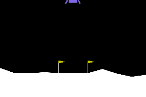

# Rocket Land: reward hacking on Lunar Lander

An agent learns exactly what you score, not what you meant. This repo trains a PPO agent to land `LunarLander-v3`, then gives it a deliberately bad reward, watches it exploit that reward, and tries a fix. Every reward is trained with 3 seeds and evaluated with the plain built-in reward, so the scores are comparable. CPU only, no GPU needed.

## The clips

| Built-in reward | `hover_hack` (the bad reward) | `potential_fix` (the fix) |
|---|---|---|
|  |  |  |
| builtin, seed 0. Lands, 304 steps, score 254.6. | hover_hack, seed 2. Never lands: still in the air at the 1000-step limit, score -120.9. | potential_fix, seed 2. Lands, 392 steps, score 239.3. |

Each clip is episode 0 of one trained model (training seed shown above, evaluation env seed 10000), not a hand-picked best run, and not a typical run of the other seeds. The `hover_hack` clip is representative of seed 2 only: in seed 0, episode 0 lands (after 932 steps). The `potential_fix` seed was chosen by a rule, the seed with the median mean score, not because the clip looks good. Details are in [results/RESULTS.md](results/RESULTS.md).

## Results

Mean ± sample std (n - 1) across 3 training seeds. Each seed is 20 deterministic episodes with the wrapper off (built-in score). "Farming" is the share of episodes that time out, in the air or on the pad. Rates are in percent.

| reward | mean score | seeds with score ≥ 200 | landed % | farming % | mean episode length |
|---|---|---|---|---|---|
| `builtin` | 256.2 ± 2.5 | 3 of 3 | 98.3 ± 2.9 | 1.7 ± 2.9 | 351.2 ± 17.1 |
| `time_fee` (built-in minus 0.03 per frame) | 267.5 ± 4.9 | 3 of 3 | 100.0 ± 0.0 | 0.0 ± 0.0 | 290.5 ± 31.9 |
| `hover_hack` (the bad reward) | 41.9 ± 105.8 | 0 of 3 | 48.3 ± 41.9 | 50.0 ± 43.3 | 965.6 ± 33.0 |
| `potential_fix` (the fix) | 222.4 ± 46.9 | 2 of 3 | 91.7 ± 14.4 | 6.7 ± 11.5 | 467.5 ± 158.0 |

All 12 runs (per seed) and more columns are in [results/RESULTS.md](results/RESULTS.md). With 3 seeds and 20 episodes each, treat the spreads as rough.

## The hack and the fix

`hover_hack` adds +1 per frame in which the lander is upright and slow (tilt under 0.2 rad, speed under 0.3), on the ground too, so staying alive pays more than landing. The agent does learn to farm it, but the seeds behave differently. Seed 2 never lands in 20 episodes: all 20 time out in the air (mean score -79.3). Seeds 0 and 1 mostly still land (70% and 75% of episodes) but take about 960 and 930 steps on average instead of about 350 for the baseline, and 25% of their episodes time out on the pad. A replay of the saved states showed all three seeds descend in slow motion, upright, rather than hovering in place or fidgeting on the pad; only seed 2 never reaches the ground.

`potential_fix` pays for improvement in the same signal rather than for being in it: reward shaping of the form γΦ(s') - Φ(s), with Φ = 10 when upright and slow, plus a 0.03 per-frame fee. Gains from entering the good state are paid back when leaving it, so there is nothing to farm by loitering. In these runs it lands again with farming back to baseline in 2 of 3 seeds (seed 1: 256.9, seed 2: 241.4, farming 0%). Seed 0 does not clear the bar: score 169.0, farming 20% (of 20 episodes: 15 landed, 1 crashed, 1 hover, 3 grounded timeouts). The recorded analysis calls this mostly seed variance on a training failure that also shows up under other rewards, but why seed 0 specifically failed could not be determined. So the fix passes a 2-of-3-seeds bar, not 3 of 3, and 3 seeds is a small sample. It is also not better than the plain reward here: `builtin` and `time_fee` already land in all 3 seeds.

## How to run

Tested on Windows 11 with Python 3.11, CPU only. Commands are PowerShell, run from the repo root.

```powershell
# 1. Environment (if `python` is not on PATH, give the full path to Python 3.11 for the venv command only; after activation `python` works)
python -m venv .venv
.\.venv\Scripts\Activate.ps1
pip install -r requirements.txt        # requirements.lock has the exact versions used for the results

# 2. Tests and a look at the environment
python -m pytest -q
python -m rocket_land.check_env --no-render --episodes 2

# 3. Quick demo: a short training run, then evaluate it (a minute or less; the model will be weak)
python -m rocket_land.train --reward builtin --seed 0 --steps 20000 --out runs/demo
python -m rocket_land.evaluate --run runs/demo --episodes 3 --gif runs/demo/clip.gif
```

Training saves `model.zip`, `config.json`, logs and TensorBoard files in `--out`. The demo model is too short-trained to land, so `evaluate` printing `FAIL: mean >= 200` is expected. A full 1M-step run took about 22 minutes on the author's laptop.

To reproduce the results, train every reward with 3 seeds and then build the report (the full run is several hours one after another; the 11 runs after the first took about 77 minutes with 4 jobs in parallel):

```powershell
python -m rocket_land.experiment --reward all --seeds 0 1 2    # runs/<reward>/seed<k>/ with eval.json and clip.gif
python -m rocket_land.report                                   # writes results/RESULTS.md
```

`report` stops with an error if any of the 12 runs is missing. Trained runs are in `runs/`, which is not part of the repo, so a fresh clone has to train before it can report. Rewards are selectable by name: `builtin`, `time_fee`, `hover_hack`, `potential_fix` (see `rocket_land/rewards.py`, where each term has a comment on what it pays for and how it can be exploited).

## Layout

- `rocket_land/rewards.py`: the reward wrappers. `train.py`, `evaluate.py`, `outcomes.py` (landed / crashed / hover / grounded timeout), `experiment.py`, `report.py`.
- `tests/`: fast tests (`pytest -q`) and slow smoke trainings (`pytest -q -m slow`).
- `results/`: the clips and `RESULTS.md`.

## Credit

The idea and the reward rules come from *Training an AI to land a rocket with reward shaping: how it works and how to build it* by Hari (@harixganesh). This repo is a separate re-implementation of that setup and is not affiliated with the author.
